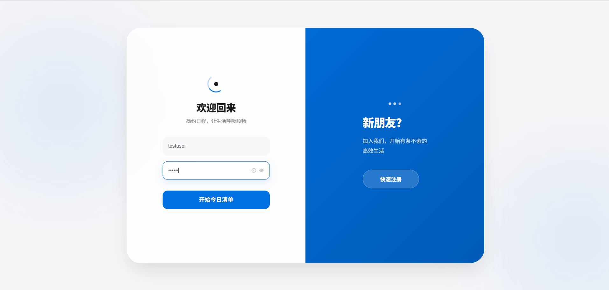
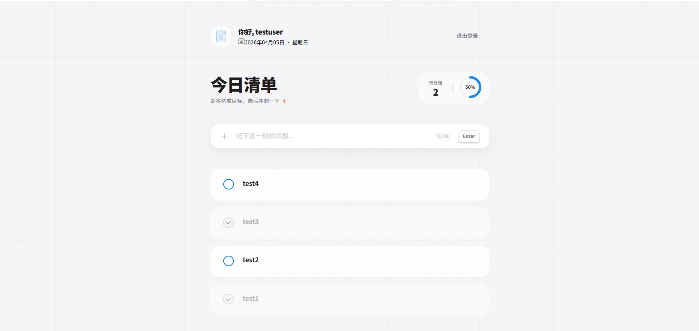
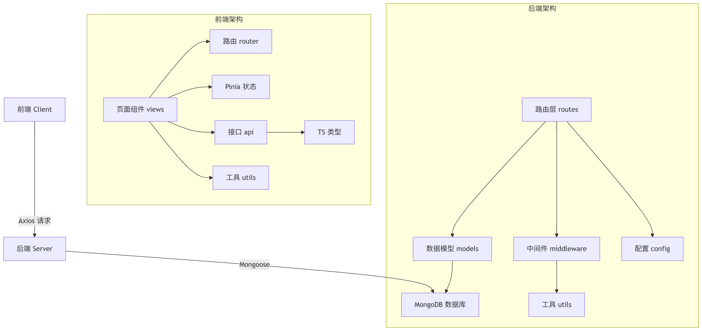

# Todo List Vue3-Express 📝

[Repository URL](https://gitee.com/its-emo/todo-list-vue3-express)

Vue3 + TypeScript + Express + MongoDB 全栈TODO应用 | 前端能力落地 + Node.js接口封装实战

## 一、核心亮点 ✨（个人能力展示）

聚焦前端核心能力落地与Node.js入门实践，兼顾视觉体验与代码规范，体现前端开发者的技术沉淀与全栈思维。

- **前端能力** 🚀：精通Vue3组合式API，规范运用TypeScript类型约束、Axios接口封装、Vue Router权限控制，代码可维护性强

- **后端实践** 🛠️：快速上手Express，掌握后端分层架构设计与接口封装，理解RESTful规范，实现前后端数据联动

- **视觉体验** 🎨：基于Element Plus搭建美观界面，响应式适配多设备，交互流畅，搭配清晰视觉设计（附页面截图）

- **规范落地** 📋：严格遵循前端工程化规范，模块化拆分、类型安全、接口统一，后端架构分层清晰，可复用性高

### 页面视觉展示 📸

简洁美观的界面设计，兼顾实用性与视觉体验，以下为核心页面截图：

**登录页面**



**TODO任务页面**



## 二、架构设计 🏗️

### 整体架构图

### 

## 三、技术栈选型 🔧

### 前端技术栈 💻

- **Vue 3**：^3.5.30

- **TypeScript**：~5.9.3

- **Pinia**：^3.0.4

- **Vue Router**：^5.0.3

- **Element Plus**：^2.13.6

- **Vite**：^7.3.1

- **Axios**：^1.13.6

### 后端技术栈 🚀

- **Express.js**：^5.2.1

- **MongoDB**：配合 Mongoose ^9.3.2

- **JWT**：jsonwebtoken ^9.0.3

- **dotenv**：^17.3.1

- **cors**：^2.8.6

- **bcryptjs**：^3.0.3

## 四、项目结构 📂

```plain text
todo-project/
├── client/                    # 前端代码
│   ├── src/
│   │   ├── api/               # API 接口封装
│   │   ├── assets/            # 静态资源
│   │   │   └── styles/        # 样式文件
│   │   ├── composables/       # 可复用的组合式函数
│   │   ├── router/            # 路由配置
│   │   ├── stores/            # Pinia 状态管理
│   │   ├── types/             # TypeScript 类型定义
│   │   ├── utils/             # 工具函数
│   │   ├── views/             # 页面组件
│   │   │   ├── auth/          # 认证相关视图
│   │   │   └── todo/          # TODO 相关视图
│   │   ├── App.vue            # 根组件
│   │   └── main.ts            # 应用入口
│   ├── vite.config.ts         # Vite 配置
│   └── package.json           # 前端依赖配置
│
├── server/                    # 后端代码
│   ├── config/                # 后端配置
│   ├── middleware/            # 中间件
│   ├── models/                # 数据模型
│   ├── routes/               # 路由
│   ├── utils/                # 工具函数
│   ├── server.js             # 服务器入口
│   └── package.json          # 后端依赖配置
│
├── docs/                     # README资源图片
│   └── images/
│       ├── 登录页.png
│       ├── 架构图.png
│       └── 主页.png
│
└── README.md                 # 项目说明文
```

## 五、核心技术细节 🔍

### 1. 前端核心实现

- **TypeScript 类型规范**：杜绝any类型，定义核心类型（Todo、User），规范接口请求/响应格式，保障类型安全。

- **Axios 接口封装**：统一请求/响应拦截，模块化管理接口，配合TS类型，调用更规范、更安全。

- **Vue Router 权限控制**：全局路由守卫，判断登录状态，实现页面访问权限管控，路由懒加载优化性能。

### 2. 后端核心实现

- **分层架构设计**：路由层、中间件层、数据模型层、工具层、配置层，职责清晰，降低耦合。

- **接口封装规范**：遵循RESTful规范，统一响应格式，模块化路由，中间件复用（认证、错误处理）。

- **JWT 认证实现**：自定义认证中间件，生成/验证token，保障接口安全，实现用户身份校验。

## 六、功能特性 📋

- 🔐 账号认证：注册/登录，JWT令牌验证，安全可靠

- 📝 任务管理：增删改查、状态同步，操作流畅

- 🎨 视觉体验：响应式设计，适配多设备，交互友好

- 📊 类型安全：TS严格约束，减少开发错误

- 🔧 规范可扩展：前后端代码规范，便于后续功能迭代

## 七、快速开始 🚀

### 前端启动 💻

```bash
# 进入前端目录
cd client
# 安装依赖
npm install
# 启动前端开发服务器
npm run dev
```

### 后端启动 🛠️

```bash
# 进入后端目录
cd server
# 安装依赖
npm install
# 复制环境变量配置文件
cp .env.example .env
# 启动后端开发服务器（热更新）
npm run dev
```

### 环境配置 ⚙️

修改后端 `.env` 文件，配置MongoDB连接地址，确保数据库正常启动即可。

## 八、个人总结 📊

本项目是我前端技术沉淀与Node.js入门实践的核心成果，重点锻炼了三大能力：

- 前端层面：熟练运用Vue3生态，规范落地TS类型约束、接口封装、路由权限，提升代码规范性与可维护性；

- 后端层面：快速上手Express，理解后端分层架构设计，掌握接口封装与RESTful规范，实现前后端联动；

- 全栈思维：学会前后端数据交互、认证逻辑实现，培养从需求到落地的全流程开发思维，为后续全栈开发打下基础。

## 九、备注 📌

1. 本地启动需确保MongoDB正常运行，环境变量配置符合本地环境；

2. 架构图、流程图可根据实际项目需求微调；

3. 后续可扩展任务分类、数据可视化等功能，进一步完善全栈能力。
    > （注：文档部分内容可能由 AI 生成）
